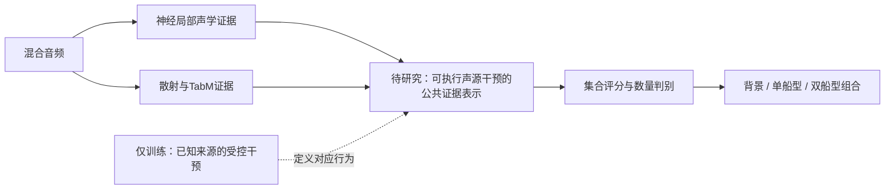

# 低信噪比水声多目标识别：核心方法候选与审稿评估

日期：2026-10-26。范围：原始论文检索、现有实验排重、方法适配与新颖性论证。本轮没有修改模型或数据，没有训练、重新划分录音或增加性能结果。

## 1. 本轮结论

**立项口径修订：**用户明确允许跨领域方法迁移、针对性机制改造，并可接受部分模块或性能的取舍。因此，不以发明全新算子、唯一恢复纯净声源或建立新因果理论作为本项目的必要门槛。IIT在目标集合识别上的任务适配仍可作为核心候选，尚未实验，不能判定为失败。需要证明的是任务动机、具体适配和相对同信息普通方法的独立价值，原方法须明确归属。

**具体实现的边界：**连续声源增益算子已完成纸面推导，与已有相位敏感源分解密切相关；该强物理解释版本不优先实施，其问题不自动否定整个IIT方向。详见[方法一：连续源干预算子与立项判断](方法一_连续源干预算子与立项判断.md)。由音频预测出的三类存在状态是合法的多标签表示，不能仅因它类似标签bit而否定；它只不足以单独证明恢复物理因果因素，应与普通概念瓶颈作同信息比较。

**目前没有候选可以直接宣布为已经确立的核心创新。建议优先论证“具有干预一致性的类别证据表示”；保留“生成式的嵌套集合假设检验”为高风险研究方向；将“类别相关部分最优传输”下调为后备。**

排序根据问题的重要性、原方法与本任务之间是否存在真实缺口、既有监督是否可用、历史排重和研究代价综合判断，不代表预计涨点幅度。

|优先级|值得研究的具体问题|学术来源|当前判断|
|---|---|---|---|
|1|改变一个声源时，模型内部能否执行与真实输入变化相对应的类别证据干预，并保持其它目标的证据？|IIT、DAS、RAVEL、因果抽象|最值得继续写方法定义；直接加入IIT损失仍只是适配，尚缺声学任务中的实质新机制|
|2|增加第二目标是否确实带来更好的观测解释，还是只解释了噪声？|扩散生成式分类、组合逆生成建模|推理思想差别明确；需要新的声学观测与证据比较机制，数据和计算风险较高|
|3|未知数量、局部证据重叠时，如何避免给缺席类别强行分配证据？|ProPOT、RAM/KCOT、部分最优传输|有针对性，但近邻已覆盖大量动机；未给出超越现有匹配的方法前，不宜作为核心立项|

本报告区分三个层次：直接迁用已有方法；针对任务改变输入、监督或输出的适配；提出能够明确定义、与近邻区分、可被反驳的新机制。下面的候选主要处于前两者向第三者过渡的位置，不能因为写出了任务动机就自动升级为方法贡献。

## 2. 科学问题应当从哪里出发

当前研究对象为PF、MB、RV三种船型的0/1/2目标集合识别，采用固定录音级划分。所有三种双目标组合均已在Train出现，不能用“未见组合的零样本泛化”描述本任务。

现有H1的神经编码与DEMON提供声学状态和数量先验，散射统计经TabM生成成员集合证据。神经状态参与成员选择；最终船型与组合评分都来自TabM成员集成，再进入数量校正及预测数量路由。它不是两个互不影响、分别独立完成Single与Double识别的分类器。

已有归档的−10 dB Test错误分解为：

|样本组|样本数|数量错误|数量正确后的类型错误|
|---|---:|---:|---:|
|Single|262|137|23|
|Double|528|68|163|

这支持两项研究需求：减少虚假的第二目标证据；形成更稳定的组合类别证据。它没有证明所有问题都来自公共决策器，也没有证明改变某种表示后必然获得诊断上限。

历史环境解耦、共享/私有表示、移源监督和成分展开实验说明：新模块被接入、参数得到更新、重建或解耦指标改善，均不足以证明跨录音识别受益。其中已经包含去旁路和相关上下文联合适配，不能把既往失败统称为没有接好或没有训练。

本轮采用以下科学问题作为筛选锚点：

> 在未知录音与低信噪比下，如何判断一份类别支持确实来自相应目标，而非其它目标、录音背景或观测扰动，并让这种支持实际决定目标集合？

这个问题本身不是首创声明。贡献必须落在回答它的具体机制，而不是将“水声多目标”“异构双分支”“抗噪”各自算作一个创新点。

现有证据来源：[创新失败原因与结构删改建议（本机出处）](../../../../../90_本机路径.md#r373)、[综合诊断与模型职责整合方案（本机出处）](../../../../../90_本机路径.md#r374)。这些是已有实验归档，本轮未重新评价。

## 3. 候选1：具有干预一致性的类别证据表示

### 3.1 原始学术来源

- [Geiger等，Inducing Causal Structure for Interpretable Neural Networks，ICML 2022](https://proceedings.mlr.press/v162/geiger22a.html)：IIT将高层变量与内部表示对应，通过交换内部状态，监督网络实现高层模型预期的反事实行为。原研究包含视觉与语言任务，并比较多任务监督和输入增强。
- [Geiger等，Finding Alignments Between Interpretable Causal Variables and Distributed Neural Representations，CLeaR 2024](https://proceedings.mlr.press/v236/geiger24a.html)：DAS在分布式表示中寻找这种对应，不要求一个概念占据原始坐标上的一组独立神经元。
- [Huang等，RAVEL，ACL 2024](https://aclanthology.org/2024.acl-long.470/)：同时评价改变指定属性与保持其它属性；其MDAS已将两种要求结合。因此，“改变一个、保留其它”本身不能被我们重新宣称为新方法。
- [Geiger等，Causal Abstraction: A Theoretical Foundation for Mechanistic Interpretability，JMLR 2025](https://jmlr.org/papers/v26/23-0058.html)：提供机制变换与干预忠实性的理论语言，不等同于对现实水声因果过程的自动识别。

### 3.2 核心原理

一个表示能够预测MB，不代表模型真正通过这部分表示识别MB。干预研究进一步要求：将与MB对应的内部状态替换后，最终输出按预期改变；其它目标的状态和判断应保留。

声学适配中的限定：未编辑目标的真实存在标签可以保持，但其可观测性与预测置信度可因归一化和遮蔽变化而改变，不能将RAVEL式属性保留直接解释为全部声学证据或logit不变。

标准分布式交换可以写成：

\[
I_c(h_b,h_d)=h_b+P_c(h_d-h_b),
\]

其中b为基础样本，d为提供待交换状态的样本，\(P_c\)是学到的子空间投影。该公式描述已有方法思想，不是本项目提出的新算子。DAS原本主要用于分析已有网络，不能将找到一个对齐子空间直接解释为识别能力提高。

我们的研究假设是：若内部类别证据的变换能够对应已知声源的替换、移除或强度变化，并在未知录音中保持这种对应，表示可能更少依赖偶然的录音相关性。这里的“可能”必须通过机制证据和正常识别共同验证。

### 3.3 为什么适合研究，又为什么不能直接照搬

本任务具有训练期已知的混合来源，可以构造受控的声源变化。它比只知道最终类别的任意自然混合，更容易定义输入侧干预及预期结果。

但声学源叠加与语言属性替换存在关键差别：

1. 两个目标可能同时作用于同一时频位置，不能默认具有空间上互斥的证据。
2. 改变源强度或移除源后，归一化会改变剩余全部成分的观察幅度，不能直接要求其深层表示逐元素不变。
3. 源录音自身携带自然环境声。已知的是合成中的录音成分，不是完全纯净的船舶物理机制。
4. 低SNR时某个目标可能本来就不可辨，不能以干预训练为理由强迫网络输出确定证据。

因此，可信的方法贡献需要落在“声学输入干预如何映射成内部证据操作”的具体建模，而不能止于多加一项反事实交叉熵。

### 3.4 必须进一步完成的机制改造

以下是本项目待论证的设计要求，尚不是实现完成或新颖性成立的结论：

- **定义有声学内容的干预变量。** 对象应是带来源、强度与观测条件的中间证据，而非直接把PF/MB/RV的三个标签比特作为可交换状态。否则可能退化为把答案写入隐层。
- **建立输入干预与表示干预的对应。** 令\(T_{c,\xi}\)表示对来源c及其参数\(\xi\)的实际混合操作，研究可否构造内部操作\(I_{c,\xi}\)，使“先改变输入再编码”与“先编码再干预”的结果在相关任务证据上对应。对应关系本身来自因果抽象思想；我们还必须解决源重叠、幅度参考及归一化造成的具体不对应。
- **限制解释范围。** 先研究已知合成因素，不能把它扩展为已经分离真实海况、船只身份与声源物理因果。使用干预算子也不保证潜变量可辨识。
- **让新表示承担实际判别职责。** 不能在其后保留一条足以完全覆盖输出的旧成员选择旁路。普通推理只能依赖当前混合音频，不能输入提供交换状态的另一录音、真实类别、真实数量或真实SNR。

概念位置如下，图中方框是待设计职责，不是已验证的新网络：

可以保留两种表征来源，但原公共成员选择应作为参照实现，而不是长期与新核心叠加。具体能否接管数量校正，取决于方法定义和后续证据，本阶段不预先删除现有数量能力。

### 3.5 与旧实验的实质边界

既往实验既有“移除目标后相应概率应变化”，也有剩余源特征匹配。仅把这些内容称为因果学习，不能形成新候选。

新方向只有在以下区别成立时才值得继续：学习的是可跨录音复用的内部干预算子；算子的行为受真实合成操作约束；相应状态确实控制最终类别判断；比较对象包含同样数据、同样监督信息的普通表示学习及原始IIT适配。

如果最后仍只是“类别查询向量＋移源损失”，就应认定与旧路线重复。如果只是对冻结网络做DAS分析，则可以形成诊断结论，但不能声称提出了更强识别模型。

### 3.6 可反驳的假设与审稿要求

|假设|需要支持它的证据|不支持时的判断|
|---|---|---|
|内部操作对应真正的来源变化|未知录音上，表示干预与实际输入干预产生相符的类别效应；不仅是训练样本的交换成功|学到了训练内编辑规则，未证明跨录音机制|
|改变指定目标不会任意损伤其它目标|目标改变与非目标保留同时成立，并报告失败样本|只有输出操纵能力，未形成选择性证据|
|该机制有识别价值|无交换、单音频正常推理优于同信息普通模型或在预定关键错误上有独立收益|干预指标改善但识别无益，不作为本文识别方法核心|

关键对照包括：普通容量匹配公共读出、概念监督瓶颈、相同来源配对的输入增强、标准IIT/MDAS式适配，以及提出的新声学干预机制。控制非目标损伤的想法已经出现在RAVEL，不能当作本项目单独的新贡献。

**代价与风险。** 训练需配对前向，推理可保持单音频输入；不必引入大规模外部预训练。主要风险是标签编码的平凡解、源录音背景混杂、低SNR不可辨性，以及干预成功却不改善自然推理。当前只建议继续方法论证，尚未达到实现立项标准。

## 4. 候选2：通过生成式证据比较检验“是否确实多一个目标”

### 4.1 原始学术来源

- [Li等，Your Diffusion Model is Secretly a Zero-Shot Classifier，ICCV 2023](https://arxiv.org/abs/2303.16203)：利用条件生成模型的密度相关估计进行分类，区别于先生成或去噪一幅样本再接普通分类器。
- [Li、Kumar、Pathak，Generative Classifiers Avoid Shortcut Solutions，ICLR 2025](https://proceedings.iclr.cc/paper_files/paper/2025/hash/28a80012e6f564c0cc8e7661e1db83fe-Abstract-Conference.html)：研究生成式分类在图像和文本分布偏移中的行为，并通过高斯玩具模型分析适用条件，不能推出水声低SNR上的普遍优势。
- [Wang、Dauwels、Du，Compositional Scene Understanding through Inverse Generative Modeling，ICML 2025](https://proceedings.mlr.press/v267/wang25x.html)：组合较小生成模型，通过逆生成推断场景内容；论文已包含多对象/多属性识别。因此，“扩散模型识别多个目标”及“枚举组合比较去噪误差”均不是我们的新思路。
- [Baggenstoss、Wilkinghoff，Novel Generative Classifier for Acoustic Events，EUSIPCO 2023](https://eurasip.org/Proceedings/Eusipco/Eusipco2023/pdfs/0000196.pdf)：声学事件中也已有生成式/判别式结合的方法，不能将“生成式分类用于声音”称为首次迁移。

### 4.2 核心原理及科学问题

普通分类器学习“观测像哪个集合”。生成式判别进一步询问“假定这个集合存在，能否合理解释当前观测”。

对于一个集合S及新增类别c，可以比较：

\[
\Delta_c(x,S)=\log p_\theta(x\mid S\cup\{c\})-\log p_\theta(x\mid S).
\]

这是已有的似然比/模型比较思想，公式本身不是创新。要做贝叶斯判别还需相应先验；未经校准的重建误差或扩散去噪误差也不能直接当成精确对数似然。

它对应我们的一项具体科学问题：强噪声或另一个目标能否被错误解释为新增船型？如果新增目标只能改善背景拟合、没有提供新的类别支持，就不应轻易改变数量。

### 4.3 形成任务贡献需要补什么

1. **建立正确的观测模型。** 波形混合可写为\(x=\mathcal N(\sum_{c\in S}A_{\eta,c}s_c+n_\eta)\)。\(\mathcal N\)包含实际幅度处理，\(\eta\)包含未知干扰及各来源的传播因素。当前加噪后还有RMS归一化，不能直接把模型入口当作未归一化的加性高斯观测。
2. **区分类别解释与干扰解释。** 需要对未知干扰条件进行边缘化或有依据的近似推断，不把测试真实SNR提供给模型；也不能让环境生成器吞掉所有弱目标。
3. **使不同集合的证据可比较。** 更多源具有更大拟合自由度，最小重建误差天然可能偏好Double。需要具有概率或模型复杂度依据的比较机制，不能只补一个验证集阈值就称为新原理。
4. **处理两路证据的依赖。** 神经和散射都来自同一波形，不能直接当作条件独立观测相乘。若在公共证据空间建模，需要说明联合密度及信息损失；被冻结前端丢失的信息不会因生成式头自动恢复。

本报告尚未提出解决上述四项的完整推断算法。因此，这是一条值得论证的机制方向，不能直接改名为新的生成式模型开始训练。

### 4.4 为什么不能直接使用视觉论文的组合公式

ICML 2025方法组合能量/去噪函数，并讨论概念独立近似及推理开销。该组合不等于水声源的波形线性叠加。我们不能将多个类别的去噪分数相加，就宣称得到正确的混合声似然。需要从声学叠加和实际观测变换出发定义模型，或明确承认是经验近似，并用相同近似的基础方法对照。

在本任务三种Double都已见过的情况下，不能照搬原文跨对象数量/未见场景的组合泛化主张。需要验证的是未知录音及噪声变化下的证据可靠性。

### 4.5 插入位置、验证逻辑与风险

位置是公共集合判别：保留特征提取基础，让候选集合的生成证据比较承担部分或全部最终判断；不能仅多一个重建辅助头，再把重建改善算成识别贡献。由于它改变推理机制，调整范围可能大于候选1。

关键对照应包含同表征普通判别头、直接七集合条件生成式分类、已有组合生成式适配，以及新增的声学观测/干扰处理机制。需区分“预测真实集合的证据优势”与“总谱拟合更好”。如果简单七类条件生成模型已带来相同收益，新增机制就没有被证明。

**主要风险：** 来源录音少时，密度模型可能优先记住背景；自然噪声比船型差异更容易主导似然；多候选、多扰动估计推理较贵；潜在维度过大时训练困难。它也与既往源成分重建失败有联系，区别必须体现为最终判别直接使用可比较的假设证据，而非再增加重建损失。研究代价高于候选1，不建议未经观测模型论证就启动。

## 5. 候选3：重叠证据下的类别相关部分匹配

### 5.1 原始来源与本轮更新

[ProPOT，Pattern Recognition 2025](https://palm.seu.edu.cn/hxue/publications/On%20Inferring%20Prototypes%20for%20Multi-Label%20Few-Shot%20Learning%20via%20Partial%20Aggregation.pdf)利用部分最优传输聚合有标签支持集的类别相关区域，以改善原型。其动态剩余质量使用支持样本的已知标签数，不能直接照搬到未知数量的查询音频。

但是，只与ProPOT比较是不够的。[RAM/KCOT，CVPR 2025](https://arxiv.org/html/2503.15337v1)已经在多标签查询识别中研究局部区域与候选类别的联合匹配，使用区域存在性边际和教师知识抑制无意义匹配。这显著压缩了“用OT减少虚假类别证据”作为新贡献的空间。训练期教师使用标签不等于其推理依赖真实数量，不能据此错误排除该近邻。

[m-LTM，ICLR 2024](https://proceedings.iclr.cc/paper_files/paper/2024/file/a0a53fefef4c2ad72d5ab79703ba70cb-Paper-Conference.pdf)也已将部分OT用于音频—文本检索，其“噪声”主要指错误配对，不能将其结果解释为水声−10 dB加性噪声的证据。

### 5.2 保留的科学问题

低SNR下，一个局部特征可能同时含有两类声源、自然背景和人工噪声。如何在允许证据重叠的同时，让缺席类保持没有支持，是值得研究的问题。

这里研究的是局部特征到类别假设的匹配，不是两分支的时间对齐。两分支来自同一波形，已知时间对应关系，因此重新做跨分支OT对齐缺少明确必要性。

### 5.3 真正需要的新机制与退化检查

- 不能使用真实查询数量决定分配质量，也不能每一类强制分到固定配额。
- 熵正则OT本来就支持软分配；“同一位置对多个类有非零权重”本身不是新机制。必须说明物理重叠使哪一种质量守恒或容量约束失效，以及新约束如何修正它。
- 不匹配/背景质量并不自动等于可靠的类别缺席证据。若只让质量自由变小，在无额外奖励、非负代价的最小化中，零匹配即可成为平凡最优；必须说明如何排除这种退化。
- 完全取消类别之间的约束，又可能退化为每类独立注意力。需要证明存在真实的联合推理作用，并与带空项的类别注意力比较。
- 不借用CLIP预训练语义作为隐含优势；本任务必须说明Train声学信息如何形成类别匹配代价。

这些要求尚未形成一个有明确求解与性质的新优化问题。仅“可学习质量＋空项＋Sinkhorn”仍可能只是现有方法组合。

### 5.4 位置、可验证假设与风险

位置应在神经时频图的全局汇聚之前，随后形成公共类别证据；已经汇总成全局概率后再做匹配，难以检验局部证据归属。

关键对照：容量匹配类别注意力（含空项）、原始平衡/部分OT、RAM式适配，以及新机制。需要同时检验弱类支持、缺席类支持和未知录音的正常识别，不能只用更好看的运输图或更少匹配质量支持结论。

代价中等，但存在配额偏见、弱目标被竞争抑制和超参数决定匹配量的风险。**本轮将其列为后备，而非已经具备核心新颖性的首选。**

## 6. 本轮不升级为核心的方向

|方向|不作为当前核心的原因|
|---|---|
|直接使用随机有限集/七集合概率输出|当前只有七个合法离散集合，任意集合后验本来就可以用七类概率表达；改变记号不等于改变推理机制。固定类别独立Bernoulli只是另一组受限参数化|
|普通共享/私有分解、信息分解或多视图一致性|与已做CUMI、环境解耦、对齐实验高度相邻；信息分解可以作为诊断语言，但必须另有新的可执行机制|
|直接换白箱Transformer、编码率约束或更复杂主干|网络名称和结构来源可以交代清楚，但迁用本身不能回答本任务的特有机制缺口|
|普通去噪后分类、散射/周期特征融合|可以成为有效基线或声学表征组件；不能因性能有用，就自动变成独立核心方法创新|
|直接给现有输出加目标增减/安慰剂响应损失|本项目已有对应实验。继续研究必须改变所检验的机制，而非更换名称或损失系数|

其中，随机集合建模对位置、关联或重复类别目标等任务可能很有价值；本报告只指出它在当前七状态分类问题中的新颖性不足，不是对该领域的普遍否定。

## 7. 先完成什么，再决定是否实现

下一项应是候选1的方法定义与近邻差异核查，内容限定为以下四件事：

1. **给出变量与干预表。** 哪个是合成来源，哪个是类别证据，哪些属于观测条件；改变来源后哪些任务量必须改变，哪些不应改变；幅度归一化如何处理。只允许0/1/2合法集合内的干预，不扩张为三目标课题。
2. **给出区别于原始IIT/MDAS的具体操作。** 原始方法已经有状态交换与非目标保护。新增部分必须是针对声学重叠与观测变换的可计算机制，而不是再加一项同义监督。
3. **先写平凡解与反例。** 三标签比特直接拷贝、分类器旁路、供体录音背景搬运、低SNR不可辨、不同来源但同类别时的操作失效。若无法从定义上区分这些情况，不进入训练。
4. **写出最接近的普通替代。** 同信息普通MLP、概念瓶颈、旧移源方法与标准IIT适配分别能做什么。新方法要证明哪个额外能力，事先明确。

完成这四项仍不等于创新成立，但可以避免用一轮训练代替方法定义。若最终设计与标准IIT只有输入和任务名不同，应诚实降级为跨领域适配，继续寻找更实质的问题，而不是通过增加模块数量强行维持“核心”称谓。

候选2在开始实现前必须先给出观测模型、集合证据的可比性和未知干扰处理；候选3必须先给出超越RAM与普通类别注意力的数学机制。目前不把三条候选排成连续训练队列。

## 8. 新颖性结论的证据范围

本轮核对了论文原文、会议/期刊发布页及作者公开稿，覆盖因果抽象与解释性、视觉多标签、音频匹配、组合生成推理与生成式分类。部分出版社页面受限时，以可访问的作者稿或正式论文集为依据；未用二手解读代替关键方法描述。

采用的针对性检索包括IIT/DAS与音频/水声、部分OT与多标签/音频、水声生成式分类、组合逆生成模型等。没有检索到直接对应候选1完整声学设计的论文，不构成“该领域从未有人做过”的证明；候选2与3已经发现重要近邻，尤其不能据任务迁移就声称首创。

本报告的最终建议是：保留现有模型作性能参照，先完成一个能够明确区分近邻、排除平凡解、提出可反驳预测的方法定义。**当前可优先研究候选1；当前不能将它写成已经解决泛化或已经成立的论文核心。**
