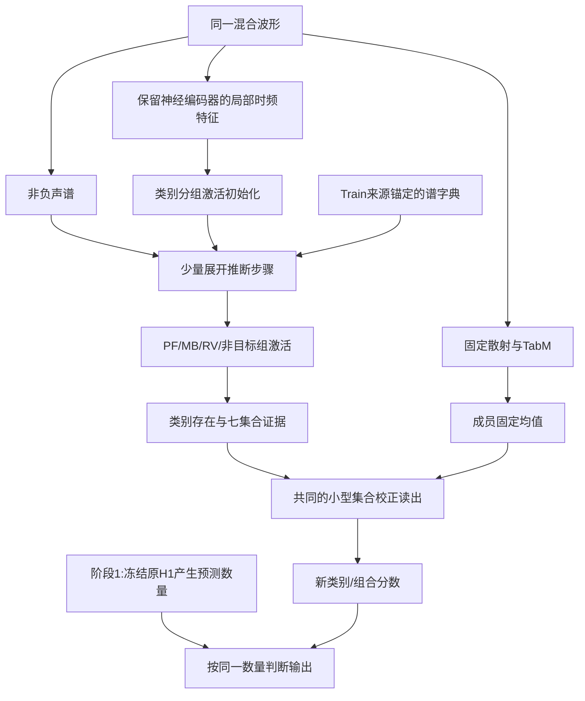

# 核心成分推断：替换方案与验证路径

日期：2026-10-26。状态为讨论方案，未实现、未删改模型、未启动训练。原H1完整模型与正式数据保留。顺序仍是先定义核心方法，再替换其所接管的旧职责，最后围绕已成立方法优化。

## 1. 明确的替换决定与方法候选

拟替换当前MemberEvidenceIntegration的32成员选择链：神经状态成员先验、成员身份嵌入，以及条件概率/偏差/熵驱动的评分器。散射/TabM先保留，32份输出取固定均值，形成稳定七集合先验。

新的方法候选是“真实成分监督锚定的类别分组展开推断”。它读取神经局部时频特征和同一波形的非负声谱，估计PF、MB、RV及非目标残余的分组激活；由激活直接产生类别存在与集合证据。不会只改变32个成员的加权，也不会仅服务训练辅助重建。

删除选择器本身是结构整理；潜在核心方法是类别成分怎样被估计、锚定，并在弱目标/噪声竞争时保有可迁移判别作用。

## 2. 计算与信息流



图中阶段1仍使用冻结H1的数量输出，只用于隔离类别方法。它不是最终删除旧选择器后的部署结构，原因见第5节。旧原始hidden不能绕过核心激活，另接神经七分类头直接进入新类别校正；否则核心又可能成为装饰。

### 2.1 类别字典与激活

令Y为同一输入的非负声谱，采用如下表示近似：

```text
Y ≈ D_PF H_PF + D_MB H_MB + D_RV H_RV + D_R H_R
```

D_c表示该组谱模板，H_c表示其随时间的激活。R是非目标或未解释残余，不解释为纯净海洋背景。类别源录音本身含环境声，不能把D_c称为纯船型物理源。

波形和复STFT有线性叠加；幅度/功率谱含相位或交叉项，上式只是受监督建模近似。不能在散射统计或任意深特征上直接声称物理可加。

初始激活来自神经局部特征的小型非负投影。将少量NMF式非负更新展开为可训练步骤，依据当前未解释谱更新各组激活。首轮固定一个轻量步数，不展开层数搜索。M2/DEMON不是核心原创，在最小筛选阶段先作共同的本任务初始化基础。

### 2.2 用实际来源确定组的语义

仅在Train，根据已有源组件、Bellhop、源增益、混合增益和包络恢复对应的录音成分。追加AWGN和输入RMS标准化时，对源监督使用与实际混合一致的增益，防止目标尺度对不上。

PF成分监督PF组，MB成分监督MB组，RV成分监督RV组；缺席类别不能靠解释背景持续激活。源不进入Val/Test正式推理，推理也不输入真实数量或船型。源组件不另导出一套WAV数据。

首轮字典/成分估计须避免强声主导：对每个实际存在类别计算自身尺度归一化的成分误差，再按类别汇总，而不是只压低整段混合谱重建误差。弱MB能量低，预测成零也许对总重建影响小，但不能因此得到很小的MB自身相对误差。

普通预测器与展开方法使用相同源监督、相同误差尺度与相同字典来源。按来源组织字典估计只使用Train，不重新排列数据，也不根据Test困难录音修改字典。

### 2.3 直接参与类别输出

对每个类别组的激活作共同的轻量时间汇聚和存在读出，得到三类支持。可借助已知集合成员关系构成七集合证据，再经相同小型读出校正等权TabM的集合分数。

PF+MB应同时获得PF和MB的成分支持，RV组不应持续伪激活。校正直接进入类别/组合分数，不再通过“选择哪个TabM成员”间接表达。小型MLP作为各组相同的读出可以保留，它不承担本方案的核心创新主张。

源监督、重建和最终集合分类同时作用于核心推断状态，核心不只输出一个供展示的分离图。若去掉成分状态后仍可沿另一条神经路径完成相同新校正，就未实现预定职责。

## 3. 与已有方法的关系

[TASLP 2024音频解释论文](https://arxiv.org/html/2305.07132)已使用神经中间激活、类别字典、背景字典及NMF重建；其IV-B3明确按类构建字典。因而“类别分组＋背景组＋重建＋稀疏”本身不能作为本项目的新贡献。

[IEICE 2023 DeMUA](https://www.jstage.jst.go.jp/article/transfun/E106.A/7/E106.A_2022EAP1098/_article)研究神经化NMF更新及音频去噪/监督分离。深度展开也不是本项目新发明。

本项目可检验的改造是：利用可追溯的混合录音成分锚定各组语义，将成分推断变为实际集合判别的必经路径，并在源强不均时减少弱类别被残余组吸收。该组合的独立价值仍需同监督、同输入的基础方法证明；不是先给网络起名便确立原创。

## 4. 阶段1：先验证类别机制

|组别|类别路径|训练状态|作用|
|---|---|---|---|
|R0|原H1成员选择与类别输出|保留固定参照|约束完整模型已有能力|
|R1|TabM成员等权|固定参照|确定简洁结构的起点|
|R2|等权先验＋普通非负激活预测器|实际训练|排除新输入/源监督/字典/读出带来的收益|
|R3|等权先验＋类别分组展开推断|实际训练|检验结构化推断是否有独立识别价值|

R2与R3共同读取局部时频图和同一声谱，估计同形状组激活，采用同一字典来源、源监督和集合读出；容量与优化预算尽量匹配。R2不是旧的全局320维七分类MLP，不能给它更少信息来衬托R3。

本阶段所有组共用q_anchor：原H1对实际当前波形产生的预测数量概率。若Train视图在线加噪，q_anchor也必须对应当前含噪波形，不能沿用原始录音的数量概率。它不是真数量。

新的类别/成分误差与固定预测数量下的正式识别共同评价；提供真实数量的类型结果仅作离线诊断。首先确认R3是否超过同监督R2并减少具体组合错误，而不是只超过R1恢复被删除选择器的损失。

只有R3有对应收益，才进入完整数量适配；不因重建好看就自动前进。首轮使用seed13和相同预算，不做种子或权重搜索。具体轮次/运行成本在实现前固定并测量。

## 5. 阶段2：适配数量接口后真正删除旧选择器

旧数量修正MLP的17维输入含：基础数量概率3维、TabM均值7维、旧成员集成概率7维。换掉成员选择时，最后7维必然改变。因此“只换类别接口但数量自动保持不变”不成立。

阶段1保留q_anchor是因果隔离安排；其计算仍包含旧选择器，所以不能对外宣称最终模型已经完全删除选择器。

阶段2将最后7维改为各候选的新集合概率，在相同条件下适配数量头、数量修正及相邻读出。此时推理不再调用旧选择器或q_anchor，才完成真实删除。数量监督继续，数量路径不因追求简洁一次性全撤。

若之后新集合判别本身可以可靠给出数量，再单独论证是否合并数量头/修正；这个后续选项不是本轮必做任务。以前已经做过统一七类输出，不能将它重新作为创新点。

## 6. 创新立足需要的三层证据

|主张|需要的证据|不够的证据|
|---|---|---|
|分组具有明确类别语义|留出录音成分与对应组匹配；缺席组受控；移除某组主要影响含该类集合|总谱重建误差降低|
|结构化推断比普通映射有价值|同输入/字典/源监督/预算下，R3超过R2，对弱目标/组合错误有对应收益|只超过等权先验|
|实际帮助完整识别|适配数量后仍有Val及统一Test收益，救回多于误伤，原始/低SNR分项在约定范围|仅辅助头ACC或真实数量条件成绩提高|

成分遮挡、置换或组激活图可以检查使用位置，不能替代去机制后重训的正式消融。若筛选成功，再补普通监督分组NMF/展开、去源锚定或去弱类平衡等必要近邻与组件对照，不一开始把所有组跑满。

## 7. 为什么这样有利于形成可论证的方法贡献

1. 问题收窄为混合声中弱类别成分容易被强声/残余吸收，而非泛称要解决所有泛化。
2. 核心从只加工最终概率，前移到类别证据形成过程，有明确状态与输入输出。
3. 真实成分监督为语义提供可检查依据，减少随意将潜变量命名为船型、环境或共享规律。
4. 新成分状态直接决定类别校正，结构上避免旧神经旁路使核心退化为辅助任务。
5. 分阶段固定/适配数量，能区分类别收益与数量偏向，不再以Single/Double相互补偿冒充问题被解决。

上述安排提高的是方法假设的清晰度、可证伪性及收益归属，不能保证一定涨点。若R2已经同样好，应将收益归于输入/源监督或普通成分表示，不强保展开网络；若只有重建改善，按先前规则停止。本轮仍处于方法讨论，不启动代码重建或训练。
