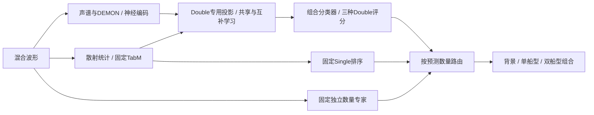

# 共享—互补表征的联合适配

本轮对比J0普通MLP、J1共享/互补结构仅CE、J2完整约束。三组统一移除组合评分直加旁路，并共同训练神经编码后段、DEMON、类别查询与Double接口。所有输入来自固定正式数据，不用外部预训练权重。



输入中的TabM评分是相同特征之一，不直接加到Double输出。数量和Single路径不随本轮Double训练改变。J1/J2推理结构及初始化相同，J2解码器仅用于训练。规则与研究终点见`PROTOCOL.md`。

- `joint_model.py`：模型、可训练上下文范围及波形入口`JointRecognizer`。
- `run_joint.py`：前缀缓存、三组联合训练、Val选择、Test评价及报告。
- `runs/joint_seed13/<组>/model.json`：每个候选的推理入口。
- `共享互补联合适配实验报告.md`：训练完成后的结果与机制诊断。

```python
from joint_model import JointRecognizer
model = JointRecognizer('runs/joint_seed13/J2_constraints/model.json')
result = model.predict(waves)  # float32 [batch,80000]，16 kHz
```

```powershell
# 在本目录重算已有结果的报告
& 'C:\Users\Admin\anaconda3\envs\zpfenv1\python.exe' run_joint.py --stage report
# 完整重跑时使用新输出目录，保留已有权重
& 'C:\Users\Admin\anaconda3\envs\zpfenv1\python.exe' run_joint.py --stage all --output runs/reproduce_seed13
```

编码器继承的是本项目固定数据上训练的共同起点；相关后段实际重新训练。冻结前缀的缓存可以复用，完整波形推理不读取特征缓存、真实数量、标签或源音频。参考权重路径和数据根在每份manifest中记录。
