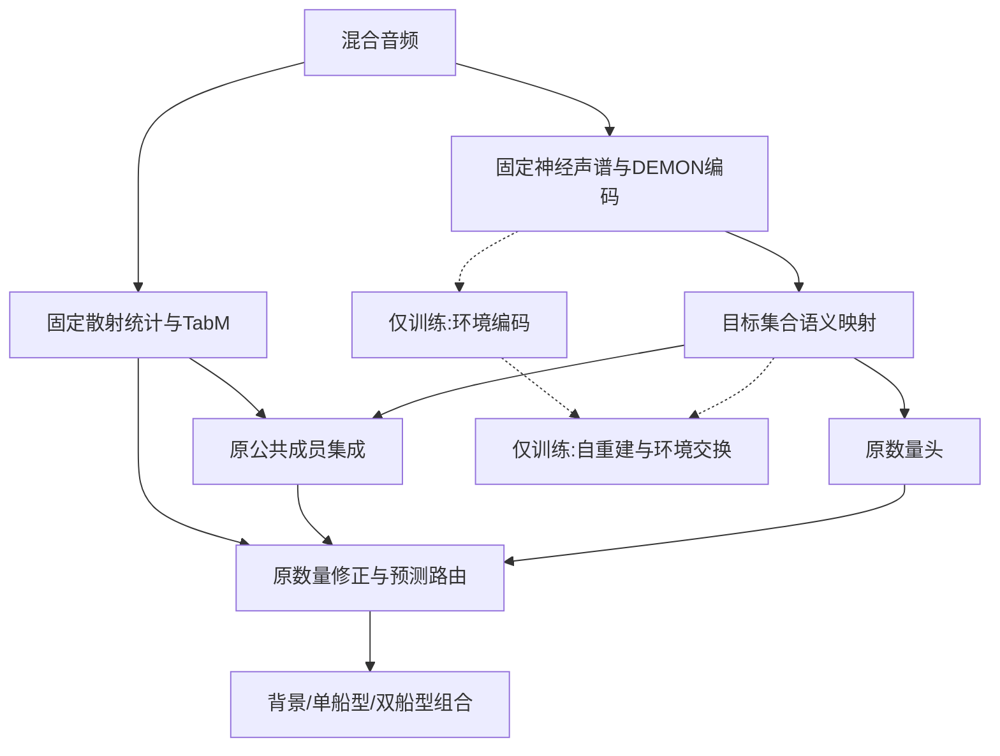

# 集合语义保持的环境解耦：方法筛选

日期：2026-10-26。固定ShipsEar录音排列与0/1/2任务，从H-transfer第12轮出发。当前工作是核心方法筛选，没有替换M2或散射专家，没有重新生成正式数据，也不展开三目标。

## 四组及唯一差异

|组别|语义映射|自重建|交换重建／环境分工|集合保护|
|---|---|---|---|---|
|E0_same_views_continue|原hidden|无|无|无|
|E1_autoencoder|可训练语义编码|有|无|无|
|E2_environment_disentangle|同E1|有|有|无|
|E3_set_preserving|同E1|有|有|有|

四组均接受相同正式标签、噪声视图、损失预算及直接语义七集合监督。E1/E2/E3推理结构相同。E2−E1检验环境分工，E3−E2检验集合保护。E0−旧H1的变化包含本轮共同训练协议及续训收益，不能当作解耦收益。

## 配对与预算

同一个正式父样本生成两份独立噪声视图。固定切片、源成分、混合增益、包络、C0/C1/C2与Bellhop；只改变追加AWGN。两视图条件都按原始/10/5/0/−5/−10的30/10/10/10/20/20概率采样。父样本内平均两视图监督，保留原背景10%、Single30%、Double60%的损失预算。实际各单类/组合保留旧row_weights规则。

直接读取固定formal audio.npy，不使用会按Single噪声条件改变包络的旧training_views。这是四组共享的协议选择，不是重新排放数据。追加噪声标签不表示原始海洋声场真实SNR；背景按既有固定参考功率加噪。

每组30轮、种子13、每轮2880个父样本、每批32个父样本（64视图），共90次更新。冻结证据每份视图只计算一次，四组共享。没有参数或种子搜索。

## 结构及训练范围



原320维hidden进入数量头和公共集成的两个入口都由新语义向量替换。语义网络用signed-ReLU的320→640→320可训练映射，无原hidden并行旁路；恒等初始化确保第0轮保持同一起点。环境码32维，只用于训练。语义映射在E1/2/3推理中增加410,560参数；辅助环境／解码器／监督头不参与部署前向。

冻结声学主干、投影、DEMON和统计，冻结散射/TabM、散射残差门控和已选波形前端。共同训练已有数量头、成员集成及17维数量修正；新模块按组训练。原特征与成员概率可缓存；新语义、读出和损失实时重算。

## 训练约束

- 共同任务：数量NLL＋Single/Double条件分类＋成员CE＋0.1语义七集合CE。TabM固定，成员CE是共同常数，不产生训练梯度。
- E1/2/3：0.1标准化L1自重建。重建尺度由Train原始特征标准差估计，最小0.1。
- E2/3：0.1同父样本交换重建、0.05环境码的噪声条件CE、0.05语义环境鉴别CE；GRL到语义的系数3轮升到0.1。环境鉴别器本身始终最小化预测损失。
- E3：集合存在边缘由语义七集合概率汇总。保护最弱存在类相对最强缺席类的log-odds间隔；背景用负的最大存在log-odds。选较轻噪声视图为参考，同档用a；仅当训练辅助七集合预测正确且间隔>0启用，参考停止梯度，上限2，容许差0.25，权重3轮升到0.05。

普通任务监督不是新贡献；AE、交换、GRL及margin均有既有基础。这轮检验任务保护的独立价值，不宣称新数学算子或第一次水声解耦。参考正确性不经真实数量路由判断，源音频/标签/噪声条件均不进入正式推理。

## 选模和结果

每组训练后只选一份权重：0.5原始Val综合＋0.5五档含噪Val综合均值，同分按原始综合。训练最佳限定epoch>=1；共同第0轮单列保留。即使训练全部退步，也输出真实训练最佳，而不是把四组都替成起点后报告“相同成绩”。Test在Val选择封存后统一评价全部六条件。

完整采用门槛启动前写在config：E3应超过E0/E1/E2，低三档综合至少+1个百分点或−10dB至少+2个百分点，并减少相对E2的Double→Single及语义分支弱类消失；保护原始及背景/低SNR分项。只以Val判采用。Test如实报告。方法失败不自动调权重、换种子或替换其它模块。

另用相同Train视图拟合独立线性探针，检查选中语义/环境编码的类别与噪声可预测性；Val评价，不用Test拟合。探针只诊断角色，不能替代识别收益。

入口：

```powershell
& 'C:\Users\Admin\anaconda3\envs\zpfenv1\python.exe' -u run.py --stage validate
& 'C:\Users\Admin\anaconda3\envs\zpfenv1\python.exe' -u run.py --stage train
```

训练后模型：`runs/seed13/<arm>_trained_best.pt`。
波形推理：`environment_model.Recognizer(checkpoint).predict(waves)`，输入float32 `[B,80000]`、16kHz。

必要检查限于初始化一致、梯度/冻结范围、有限损失及部署前向一致性，不增加哈希或全量数据质量检查。旧模型、正式数据和历史结果均保持。
