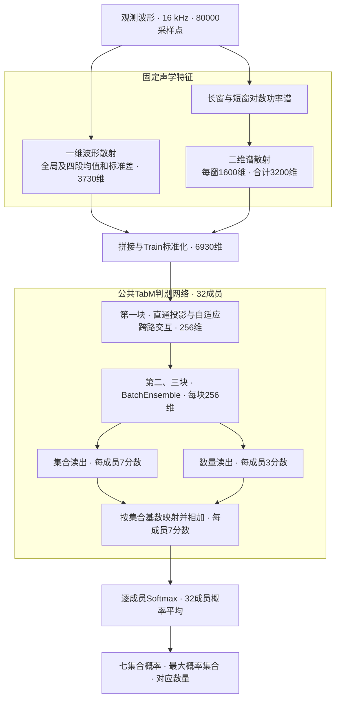

# ShipsEar 双视图模型架构说明

本文记录 V1／P50 的历史架构。当前 ShortLocal-GN 使用短窗 log-Mel 局部 CNN 和七集合直接读出，保留数量边际辅助损失。 [当前结构图（本机出处）](../../../../../90_本机路径.md#r438) · [当前消融与方法归属](消融实验/README.md)

本模型对一段 16 kHz、5 秒的单通道水声波形进行识别。固定一维波形散射和长短窗二维谱散射生成两路声学特征，公共判别网络通过成员条件交互融合证据，再用集合读出和数量读出共同计算七个合法目标集合的分数。两路特征服务于同一个识别任务。



## 两路固定声学特征

| 视图 | 计算 | 输出维数 |
|---|---|---:|
| 一维波形散射 | 对整段波形应用 Kymatio `Scattering1D`，取一阶和二阶系数。系数下限设为 `1e−12` 后取自然对数，分别在全局和四个连续时间段汇总均值、总体标准差。 | 373条路径 × 5个时间范围 × 2项统计 = **3730** |
| 长窗二维谱散射 | 对长窗原生对数功率谱计算二维散射，在散射系数图上用 `8 × 4` 自适应网格汇总均值、标准差。 | 25条路径 × 32个网格 × 2项统计 = **1600** |
| 短窗二维谱散射 | 在短窗原生谱图上执行同一二维散射与空间汇总，与长窗结果拼接。 | **1600** |

一维散射设置 `J=10`、`Q=8`、`max_order=2`。两种时频图均使用 Hann 窗和居中 STFT，保留 0–4000 Hz，计算 $\log(|\mathrm{STFT}|^2+10^{-6})$。

| 时频图 | FFT和窗长 | 帧移 | 原生频率格 × 时间帧 |
|---|---:|---:|---:|
| 长窗 | 8192 | 1024 | 2049 × 79 |
| 短窗 | 2048 | 256 | 513 × 313 |

二维散射使用 `J=2`、`L=4`、`max_order=2`，25条路径包含零阶系数。实现先将原生谱图存为 float16，再以 float32 计算二维散射和统计量。网格内标准差通过 $\sqrt{\max(\operatorname{mean}(x^2)-\operatorname{mean}(x)^2,0)}$ 计算。两路特征拼成 6930 维向量，使用 Train 的逐维均值与尺度计算 $(x-\mu)/\sigma$。归一化统计量随权重保存。

## 公共判别与跨路交互

公共网络沿用 TabM 的 BatchEnsemble 主干。输入扩展到 32 个成员，三块隐藏层宽度均为 256，每块依次执行线性变换、ReLU 和 dropout（0.15）。每块的主权重矩阵由成员共享，成员各有输入缩放、输出缩放和偏置。第一块把线性变换扩展为校准交互，后两块使用原生 BatchEnsemble 线性变换。

设 $x$ 为标准化后的 6930 维输入，$r_m$ 和 $s_m$ 分别是成员 $m$ 第一块的输入与输出缩放。以 $\odot$ 表示逐元素乘法，第一块的激活前输出为

$$
\begin{aligned}
\tilde{x}_m &= x\odot r_m,\\
u_m &= W_{1\mathrm{D}}\tilde{x}_{m,1\mathrm{D}},\qquad
v_m = W_{2\mathrm{D}}\tilde{x}_{m,2\mathrm{D}},\\
t_m &= u_m\odot v_m,\\
d_m &= (W\tilde{x}_m)\odot s_m+b_m,\qquad
c_m = (W_p t_m)\odot s_m,\\
h^{\mathrm{pre}}_{1,m} &= d_m+g_m c_m.
\end{aligned}
$$

两路投影将 3730 维和 3200 维分别压到 64 维，逐元素乘积经共享投影恢复为 256 维。三个交互投影均为无偏置线性层。门控输入由 $u_m$、$v_m$、$t_m$ 的 192 个层归一化坐标及 4 项强度统计组成。四项强度是前三者的 `log1p(RMS)` 及交互与直通分量的 `log1p(RMS)` 之差。共享门控网络执行 `Linear(196,16) → GELU → Linear(16,1)`，再由 $g_m=2\operatorname{sigmoid}(\cdot)$ 生成逐样本、逐成员的标量权重。

| 参数组成 | 可训练参数 |
|---|---:|
| 三块 BatchEnsemble 主干，含成员缩放和偏置 | 2,192,448 |
| 两路低维投影和交互输出投影 | 459,904 |
| 自适应门控 | 3,169 |
| 七集合读出 | 57,568 |
| 三数量读出 | 24,672 |
| **合计** | **2,737,761** |

两路散射与 Train 标准化为固定计算。参数表由 V1 参考和 P50 保存权重逐张量核对，两份权重的参数布局及总量一致。

## 七集合读出和训练目标

| 输出索引 | 0 | 1 | 2 | 3 | 4 | 5 | 6 |
|---|---|---|---|---|---|---|---|
| 集合 | `E` | `PF` | `MB` | `RV` | `PF+MB` | `PF+RV` | `MB+RV` |
| 数量 | 0 | 1 | 1 | 1 | 2 | 2 | 2 |

`E` 表示背景。数量定义为合法集合的基数，本任务覆盖背景、三种单船型和三种不同船型组合。每个成员的第三块输出分别进入 7 维集合线性读出和 3 维数量线性读出。令集合分数为 $a_{m,s}$，数量分数为 $b_{m,n}$，集合基数映射为 $n(s)$。模型计算

$$
z_{m,s}=a_{m,s}+b_{m,n(s)},\qquad
p_m=\operatorname{softmax}(z_m),\qquad
q_{m,n}=\sum_{s:n(s)=n}p_{m,s}.
$$

数量读出给同一基数的集合分数加上共同偏移，调整不同基数集合之间的竞争。训练对每个成员计算真实集合的交叉熵，以及真实数量对应的七集合概率边际损失。

$$
\mathcal{L}=
\frac{1}{B}\sum_{i=1}^{B}w_i\frac{1}{32}\sum_{m=1}^{32}
\left[-\log p_{i,m,y_i}-0.1\log\big(\max(q_{i,m,n(y_i)},10^{-12})\big)\right].
$$

损失预算按背景 0.1、各 Single 集合 0.1、各 Double 集合 0.2 分配，再由集合内样本平分。实现将总和为 1 的 Train 样本权重乘以 Train 样本数得到 $w_i$。数量损失通过联合后的七集合概率回传，同时更新集合读出、数量读出和公共主干。

## 训练记录与权重来源

| 保存权重 | 累计轮次 | 记录用途 |
|---|---:|---|
| `weights/V1_reference.pt` | 51 | 源 V1 参考。由 F1M1 第33轮的任务权重继续训练，保存 V1 第18轮。 |
| `runs/seed13/P50_noise50_best.pt` | 71 | 后续开发参考。沿用 V1 的固定视图和 Train 归一化，在 P50 分布下选中续训第20轮。 |

P50 每轮按原始波形 50%、10／5／0／−5／−10 dB 各 10% 采样。同期 P25 使用原始 25%、五档各 15%。各类采用同一采样概率。原始条件直接读取存储波形。加噪时将高斯噪声去均值并归一到单位 RMS，按 $\sqrt{P_{\mathrm{ref}}/10^{\mathrm{SNR}/10}}$ 缩放后叠加。含目标样本取波形平均功率作为 $P_{\mathrm{ref}}$，背景样本取 $0.05^2$，叠加结果统一调到 RMS 0.05。

续训采用种子 13、AdamW、学习率 `3e−5`、权重衰减 `1e−4`、梯度裁剪 5、训练批量 32。两路固定特征和 Train 统计量随 V1 保留，公共判别网络参与更新。P50 前20轮来自相同训练协议的 `A_continue`。前20轮按本轮 Val 规则重新排序，选中第20轮并回放六档 Val，再从该轮的权重和优化器状态接续训练。

本轮采用字段 `chosen_by_Val=null`，当次采用规则保留源 V1。P50 作为后续工程回放和正式方法复现的开发参考。完整随机起点训练日程、正式消融和外部对比的共同选模规则见统一收尾路线。 [统一收尾路线](统一收尾路线.md) · [两分布阶段结论](../shipsear_final_noise_distribution_20261102/阶段结论.md) · [波形与AWGN实现（本机出处）](../../../../../90_本机路径.md#r010)

## 推理和实现来源

推理接口读取形状为 `N × 80000` 的观测波形。特征提取使用批量 32，分类使用批量 64。CUDA 分类前向采用 bfloat16 自动混合精度，逐成员 Softmax 使用 float32，随后在 CPU 端用 NumPy 平均 32 组概率。最终取平均概率最大的集合，并按表中映射返回数量。训练标签仅用于训练和离线评价。

在独立模型包目录执行以下命令可回放 P50 开发参考。输出包括 `probabilities`、`predictions`、`counts` 和 `sets`。

```powershell
python predict.py --checkpoint runs/seed13/P50_noise50_best.pt --input waves.npy --output predictions.npz --device cuda
```

TabM 主干沿用本地原版 0.0.3，数值嵌入依赖 `rtdl_num_embeddings` 为 0.0.12，两者采用 Apache 2.0。固定波形和谱散射调用 Kymatio 0.3.0 的 PyTorch 实现，采用 BSD 3-Clause。项目代码实现双视图汇总、首块校准交互和数量与集合联合读出，代码出处与许可证文件随独立包保留。 [模型实现](../../../../../03_论文写作/引用资料/1492_model.py) · [参数设置](../shipsear_final_noise_distribution_20261102/config.json) · [依赖出处及许可证](../../../../../03_论文写作/引用资料/1493_README.md)
