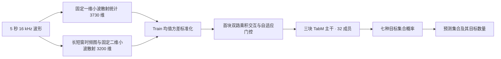

# ShipsEar Q0 冻结模型

正式版本 `SE-Q0-MBTrainValSwap-13`。种子 13 从模型构造初值起跑 50 轮，按六档 Val 排序封存第 40 轮，再评价 877 条 Test。Train／Val／Test 分别为 2877／719／877 条。MB 21、33 号进入 Train，27、50 号进入 Val。这次划分由原 Val 的困难录音引导。 [数据划分](../shipsear_mb_train_val_20261104/README.md)

## 模型



交互位于 TabM 第一块。两路各投影到 64 维，逐元素相乘后投影到 256 维，经门控加回该层的直通输出。32 个成员各输出七种集合的分数，推理时先对各成员做 softmax，再平均概率取最大项。最终数量由预测集合的成员数确定。训练时另对七集合概率的数量边缘分布计算辅助损失，系数为 0.1。公共网络有 2,713,089 个可训练参数。

## 冻结成绩

| 条件 | 综合 ACC | Single | Double | 背景 |
| --- | ---: | ---: | ---: | ---: |
| 原始 | 87.91% | 92.37% | 83.71% | 100% |
| 10 dB | 84.15% | 84.35% | 81.44% | 100% |
| 5 dB | 80.96% | 82.06% | 77.27% | 100% |
| 0 dB | 74.23% | 77.10% | 68.56% | 100% |
| −5 dB | 63.28% | 68.70% | 54.55% | 100% |
| −10 dB | 46.52% | 65.27% | 28.41% | 100% |

## 推理与验收

在本目录使用 `zpfenv1` 的 Python 运行。已验收环境为 RTX 5090、Python 3.10.19、PyTorch 2.9.0+cu128、NumPy 2.1.2、SciPy 1.15.3、packaging 25.0 和 typing-extensions 4.15.0。TabM 及 Kymatio 代码和许可证随附于 `vendor/`。

```powershell
python predict.py --input path/to/waveforms.npy --output predictions.npz
python verify_release.py
```

`predict.py` 默认加载 `weights/best.pt`。输入是准备好的单声道 5 秒片段，形状为 `(N, 80000)`，采样率 16 kHz。输出含 `probabilities`、`predictions`、`counts`、`sets`。七集合顺序为 E、PF、MB、RV、PF+MB、PF+RV、MB+RV。推理只需发布包及运行依赖。六档回放还需原数据，默认从冻结配置读取数据路径，迁移数据后可用 `verify_release.py --data-root <路径>`。

发布版首块交互固定为乘积与自适应门控。历史门控、替代交互和训练专用的数据函数由原实验入口保留。种子 13 下，发布版与原训练构造的 23 个状态张量及构造后的随机数状态逐项一致。

精简后用同一份第 40 轮权重逐条重放六档 Val 和 Test。12 组共 9,576 条评价视图的预测和概率全部一致，概率最大绝对差为 0。 [回放验收](./records/release_verification.json)

## 训练与结果溯源

- [封存权重](./weights/best.pt)包含第 40 轮参数及仅由新 Train 拟合的归一化统计。模型使用已封存的权重直接推理。
- [冻结配置](./config.json)、[50 轮历史](./records/history.json)、[选轮记录](./records/selection_sealed.json)和[六档完整结果](./records/results.json)来自同一次训练。逐条预测、按源录音统计和冻结数据索引也在 `records/`。
- 原始训练入口为 `train_formal.py --mb-train-val-swap`。该入口留在正式实验工作区，训练从模型构造初值开始。旧 P50／V1 仅出现在历史参考记录中。 [完整训练入口](../shipsear_finalization_20261103/train_formal.py) · [原训练报告](../shipsear_finalization_20261103/Q0仅MB录音交换完整训练报告.md)

这次整理复用了封存检查点并通过了全量回放，无需为整理再训练。若正式实验需要报告种子方差，按同一冻结协议另起运行即可，当前成绩对应种子 13。
